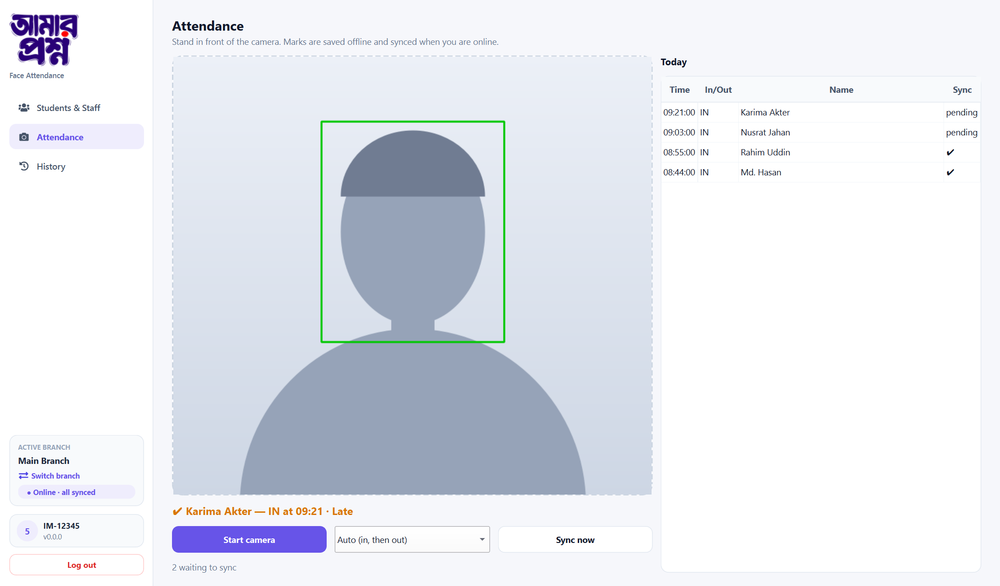
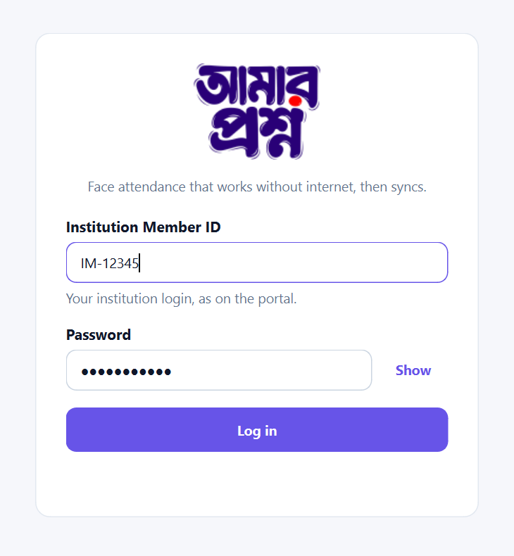
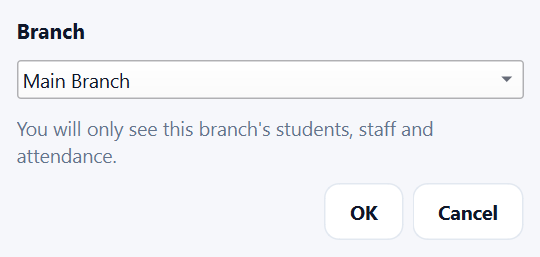
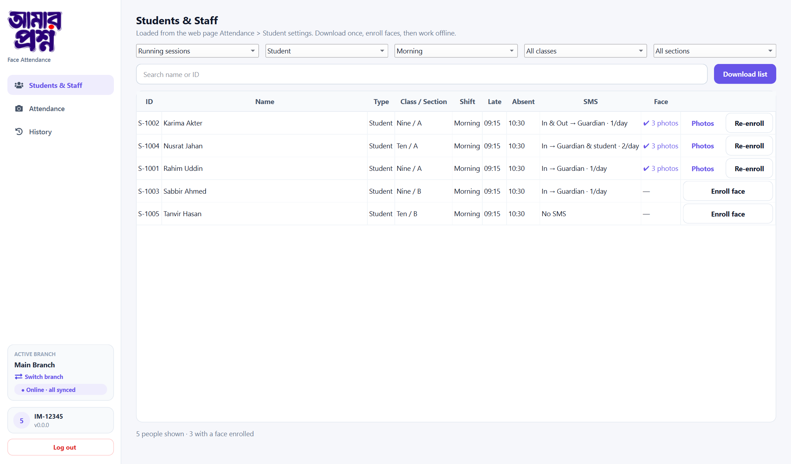
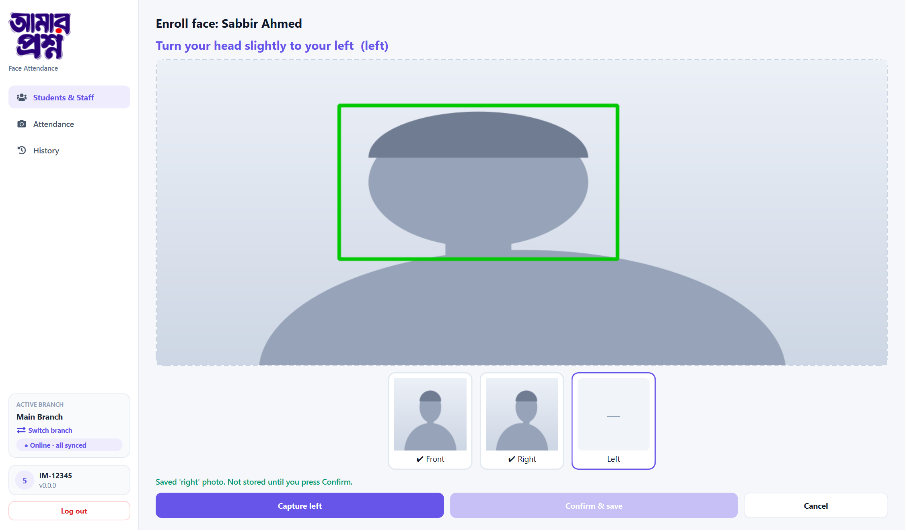
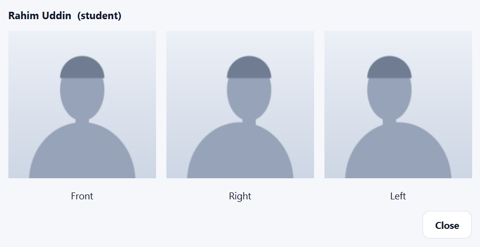
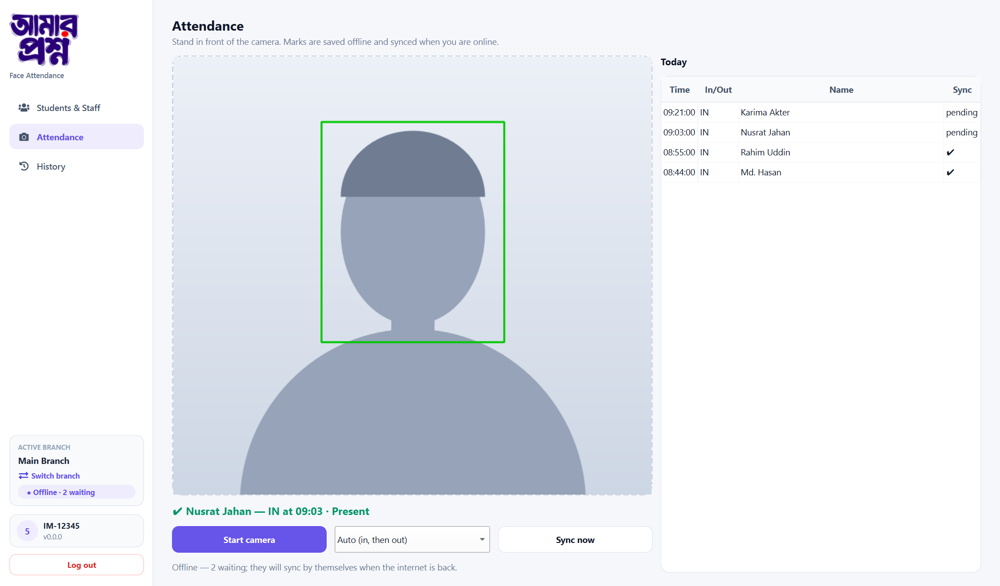
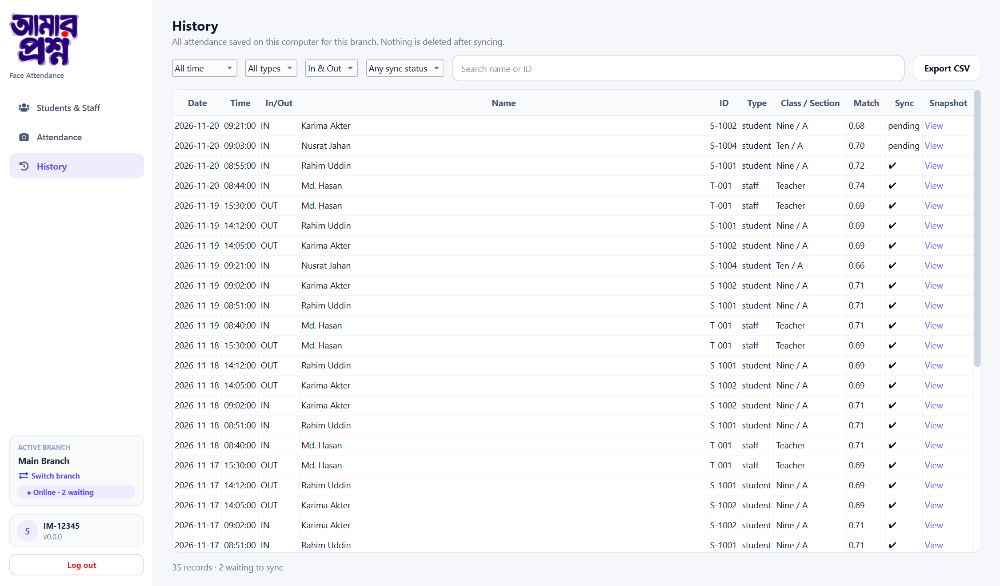

# AmarProsno Face Attendance — Offline Face Attendance Software for Windows

**Free face-recognition attendance software** for schools and colleges — take
student and staff attendance in front of a webcam **without internet**, and
send it to [amarprosno.com](https://amarprosno.com) automatically when the
internet is available. No special hardware, no graphics card.

> **মুখ চিনে হাজিরা (অফলাইন)** — ওয়েবক্যামের সামনে দাঁড়ালেই ছাত্রছাত্রী ও
> শিক্ষক-কর্মীর হাজিরা (In / Out) হয়ে যায়। ইন্টারনেট না থাকলেও চলে; ইন্টারনেট
> ফিরলে হাজিরা নিজে থেকে [আমার প্রশ্ন](https://amarprosno.com)-এ চলে যায়।

**Features:** attendance by face · check-in and check-out · works offline and
syncs by itself · same student / staff list and late / absent rules as the
website · branch-wise data · full history with CSV export · automatic updates.

**[⬇ Download the latest version](https://github.com/avro0184/amarprosno-face-attendance/releases/latest)**
— open the page, then click **AmarProsnoFace-Setup-x.x.x.exe** under *Assets*.

> Windows 10 / 11 (64-bit) with a webcam. No admin rights needed. About 700 MB
> of disk space. A macOS (Apple Silicon) `.dmg` is attached to a release when it
> is available.

*The screenshots on this page use demo data — a made-up school and made-up
names. The face pictures are placeholders.*

---

## 1. Install

1. Download `AmarProsnoFace-Setup-x.x.x.exe` from the link above.
2. Double-click it. If Windows shows *"Windows protected your PC"*, click
   **More info → Run anyway**.
3. Click **Next → Next → Install**, then **Finish**. The app opens by itself.

You only install once — later versions update from inside the app (see
[Updates](#8-updates)).

## 2. Log in

Enter your institution **Member ID** (for example `IM-12345`) and **password** —
the same ones you use on the institution portal. If your institution has more
than one branch, pick the branch you work in; you will only see that branch's
people and attendance. You can change it later with **Switch branch** at the
bottom left.

> The first login needs internet. After that the app keeps you signed in, so
> it opens and works even when the internet is down.

## 3. Get the student and staff list

The list comes from the website page **Attendance → Student settings** — the
people who are added there are the people who appear in the app (with their
class, section, shift, late time, absent time and SMS rule). **Add people on
the website first.**

In the app, open **Students & Staff** and click **Download list**. Use the
filters to find people quickly:

| Filter | What it does |
|---|---|
| **Session** | which academic session to download (default: the running sessions) |
| **Type** | all / student / teacher-staff |
| **Shift → Class → Section** | narrow the list step by step (works offline) |
| **Search** | by name or ID |

## 4. Enroll faces

1. In the list, click **Enroll face** next to a person.
2. Follow the instruction on top of the camera — **front → right → left** —
   and click **Capture** (or press **Space**) for each one.
3. Click any small photo to **retake** just that one.
4. Click **Confirm & save**. Nothing is saved until you confirm; **Cancel**
   leaves the old photos as they were.

Later, click **✔ photos** in the *Face* column (or **Photos**) to look at the
saved photos, and **Re-enroll** to change them.

**For good results:** one face in the frame · face lit from the front, not
from behind · close enough that the face is clearly visible · no cap or mask.

## 5. Take attendance

Open **Attendance**, click **Start camera**, and let people look at the camera.
The name and time appear on screen and the record is saved.

Choose the mode next to the button:

- **Auto (in, then out)** — the first scan is **IN**; a scan 30 minutes or more
  later is **OUT**. After that the person is *already checked out* for the day.
- **Check-in only / Check-out only** — every scan counts as that direction (for
  example a morning gate and an evening gate). Each person is recorded once a
  day per direction.

For check-in the screen also shows **Present / Late / Absent** using the late
and absent times from the website. This is only a hint — the final status is
decided by amarprosno.com.

## 6. Works without internet

- **Internet available:** each record is sent to amarprosno.com right away.
- **No internet:** records are kept safely on the computer and the sidebar shows
  *● Offline · 3 waiting*. The app tries again by itself every minute or so;
  when the internet is back everything is sent — you do not need to do anything.
  **Sync now** just forces an immediate try.
- **Closed the app?** Waiting records are still there and are sent the next
  time you open it and the internet is available.

If the sidebar says *Session expired*, log in again — the records stay safe and
are sent after you log in.

## 7. History

The **History** tab shows every attendance record saved on this computer for the
branch — including what is already sent. Filter by date (today, last 7 / 30
days, custom), type, in / out and sync status, search by name or ID, click
**View** to open the camera snapshot taken at that moment, and use
**Export CSV** to open the records in Excel.

## 8. Updates

When a new version is released, the app downloads it in the background and shows
a banner. Click **Restart & Update now**, or just close the app — the update is
installed when you close it. Your data (people, face photos, history) is kept.

## 9. Privacy

- **Face photos and face templates stay on your computer** (in
  `%APPDATA%\AmarProsnoFace`). They are **not** uploaded to amarprosno.com.
- Only the attendance records (who, in / out, date and time) are sent to
  amarprosno.com.
- Get the consent of every person (or their guardian) before enrolling a face,
  and protect the computer with a password. Back up the `AmarProsnoFace` folder
  if you want to keep the photos.

## 10. Troubleshooting

| Problem | What to do |
|---|---|
| The list is empty | The people must be added on the website first: **Attendance → Student settings**. Then click **Download list**. |
| *Could not open the camera* | Close other programs that use the camera (Zoom, Teams, …). In Windows **Settings → Privacy → Camera**, allow desktop apps to use the camera. |
| A person is *not recognised* | Enroll again with better light, closer to the camera, facing the camera. |
| Records stay *pending* | The computer has no internet, or the website did not accept them — hover over the status in the sidebar to see the reason. They are not lost; they go when the problem is gone. If you work in more than one branch, records of another branch are sent when you switch back to that branch. |
| Windows SmartScreen blue screen | Click **More info → Run anyway** (the app is new and not yet widely known to Windows). |
| First start takes a few seconds | The face model is loading once; the next scans are quick. |

> Face recognition can make mistakes. Always look at the records, especially
> for people who look alike.

## Support

Questions or problems? Call or WhatsApp **01884689484 / 01572906168**, or visit
[amarprosno.com](https://amarprosno.com).

The software is free to use for your own institution with an amarprosno.com
account; the licence text is shown during installation.
